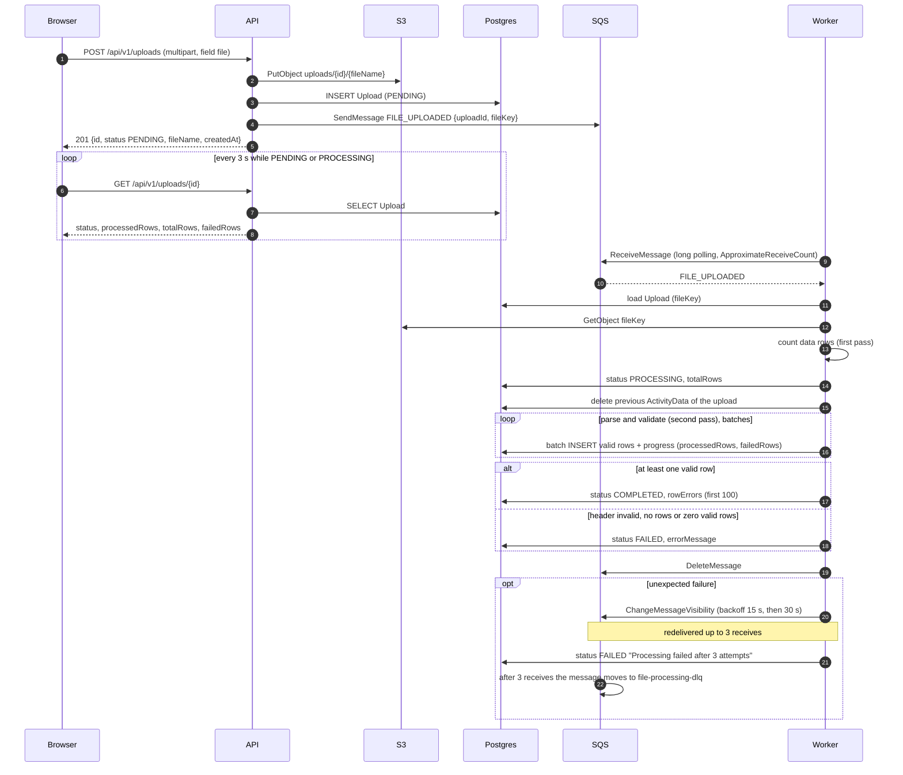
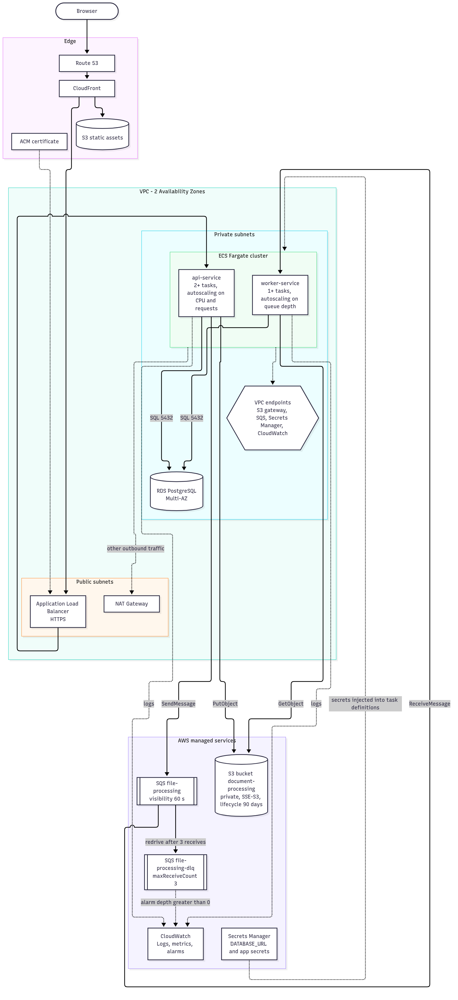

# CarbonBox · Procesamiento asíncrono de documentos

<!-- TODO (candidato): al publicar el repositorio en GitHub, reemplazar esta línea por el badge de CI:
[](https://github.com/<usuario>/<repositorio>/actions/workflows/ci.yml)
Mientras el repositorio no se publique, el workflow no se ha ejecutado en GitHub (ver "Limitaciones conocidas"). -->

## Descripción del proyecto

Sistema de procesamiento asíncrono de archivos CSV de datos de actividad (categoría,
cantidad, unidad, fecha) para la prueba técnica Full Stack de CarbonBox.

1. El usuario sube un CSV desde el frontend (Next.js).
2. La API (Fastify) guarda el archivo en S3, crea un registro `Upload` en PostgreSQL con
   estado `PENDING` y publica un mensaje en SQS. Responde `201`.
3. Un worker (proceso aparte, `npm run worker`) consume el mensaje, descarga el archivo,
   valida cada fila, guarda las filas válidas y deja el `Upload` en `COMPLETED` o `FAILED`.
4. El frontend consulta el estado cada 3 s mientras sea `PENDING` o `PROCESSING` y muestra
   el progreso, los resultados y los errores por fila.

El backend sigue DDD + Clean Architecture + CQRS, con un modelo de errores `Either` e
inyección de dependencias con Awilix. La infraestructura local (PostgreSQL y LocalStack
con S3 y SQS) corre con Docker Compose.

## Requisitos previos

- Node.js 24 (hay un `.nvmrc`) y npm 10 o superior.
- Docker con Compose v2.
- Puertos libres: 3000 (frontend), 4000 (API), 5432 (PostgreSQL) y 4566 (LocalStack).

## Instalación y ejecución

Todos los comandos se ejecutan desde la raíz del repositorio salvo que se indique otra
ruta.

### Opción A: infraestructura en Docker + apps locales

```bash
# 1. Infraestructura: PostgreSQL y LocalStack (crea bucket, cola y cola de mensajes fallidos)
docker compose up -d

# 2. API (terminal 1)
cd backend
npm ci
npm run prisma:migrate     # aplica las migraciones (prisma migrate deploy)
npm run prisma:generate    # genera el cliente de Prisma en src/generated/prisma
npm run dev                # API en http://localhost:4000

# 3. Worker (terminal 2)
cd backend
npm run worker

# 4. Frontend (terminal 3)
cd frontend
npm ci
npm run dev                # http://localhost:3000
```

El orden de `prisma:migrate` y `prisma:generate` importa poco entre sí, pero ambos deben
ejecutarse antes de `npm run dev`. `npm ci` no genera el cliente de Prisma.

### Opción B: todo en Docker

```bash
docker compose --profile app up --build
```

Levanta PostgreSQL, LocalStack, un servicio de migraciones (`migrate`, termina al acabar),
la API (`api`), el worker (`worker`) y el frontend (`frontend`). Abre
http://localhost:3000. Para detener solo los servicios de la aplicación y dejar la
infraestructura:

```bash
docker compose --profile app stop api worker frontend migrate
docker compose --profile app rm -f api worker frontend migrate
```

`docker compose --profile app down` detiene y elimina también PostgreSQL y LocalStack
(los volúmenes se conservan).

`NEXT_PUBLIC_API_URL` se incrusta en el frontend en tiempo de build y apunta a
`http://localhost:4000/api/v1`, porque es el navegador (en el host) quien llama a la API.

### Variables de entorno

La API y el worker leen la configuración con Convict (validada al arrancar). Hay un
archivo por entorno en `backend/`: `.env.example` (plantilla), `.env.development`,
`.env.test` y `.env.docker` (usado por el perfil `app` de Compose). Son valores locales,
sin secretos reales. El archivo `.env` (no versionado) puede sobrescribirlos.

| Variable | Default | Descripción |
|----------|---------|-------------|
| `NODE_ENV` | `development` | `development`, `test` o `production`; elige el archivo `.env.<NODE_ENV>` |
| `PORT` | `4000` | Puerto de la API |
| `HOST` | `0.0.0.0` | Interfaz de escucha |
| `LOG_LEVEL` | `info` | Nivel de pino |
| `DATABASE_URL` | (obligatoria) | Conexión a PostgreSQL |
| `AWS_REGION` | `us-east-1` | Región AWS |
| `AWS_ENDPOINT` | vacío | Endpoint de AWS; en local, LocalStack (`http://localhost:4566`) |
| `AWS_ACCESS_KEY_ID` / `AWS_SECRET_ACCESS_KEY` | `test` / `test` | Credenciales (LocalStack acepta cualquier valor) |
| `S3_BUCKET` | `document-processing` | Bucket de los CSV |
| `S3_FORCE_PATH_STYLE` | `true` | Necesario para LocalStack |
| `SQS_QUEUE_URL` | (obligatoria) | URL de la cola `file-processing` |
| `WORKER_WAIT_TIME_SECONDS` | `20` | Long polling del worker |
| `WORKER_VISIBILITY_TIMEOUT_SECONDS` | `60` | Visibility timeout al recibir |
| `WORKER_MAX_MESSAGES` | `1` | Mensajes por recepción |
| `WORKER_MAX_RECEIVE_COUNT` | `3` | Recepciones antes de declarar el fallo definitivo |
| `WORKER_POLL_BACKOFF_MAX_MS` | `30000` | Tope del backoff cuando la cola no responde |
| `WORKER_RETRY_BACKOFF_BASE_SECONDS` | `15` | Base del backoff por mensaje |
| `WORKER_RETRY_BACKOFF_MAX_SECONDS` | `60` | Tope del backoff por mensaje |
| `UPLOAD_MAX_FILE_SIZE_BYTES` | `5242880` | Tamaño máximo de subida (5 MiB) |
| `DEFAULT_USER_ID` | `user-123` | Usuario fijo (no hay autenticación) |
| `CORS_ORIGIN` | `http://localhost:3000` | Origen permitido por CORS |

Frontend: `NEXT_PUBLIC_API_URL` (default `http://localhost:4000/api/v1`) en
`frontend/.env.example` y `frontend/.env.development`.

### Scripts disponibles

Backend (`backend/`):

| Script | Descripción |
|--------|-------------|
| `npm run dev` | API con recarga (`tsx watch`) |
| `npm run worker` | Worker de procesamiento (proceso separado) |
| `npm run build` | Compila a `dist/` y copia el runtime del cliente de Prisma |
| `npm start` / `npm run worker:start` | API / worker compilados |
| `npm run lint` / `format` / `format:check` / `typecheck` | Calidad estática |
| `npm test` | Todas las pruebas (unitarias e integración) |
| `npm run test:unit` / `test:integration` / `test:coverage` | Subconjuntos y cobertura |
| `npm run prisma:generate` | Genera el cliente de Prisma |
| `npm run prisma:migrate` | Aplica las migraciones (`migrate deploy`) |
| `npm run prisma:migrate:new -- <nombre>` | Crea una migración (`migrate dev --name`) |
| `npm run prisma:studio` | Prisma Studio |

Frontend (`frontend/`):

| Script | Descripción |
|--------|-------------|
| `npm run dev` | Servidor de desarrollo de Next.js |
| `npm run build` / `npm start` | Build de producción / servidor |
| `npm run lint` / `npm run typecheck` | Calidad estática |
| `npm test` | Pruebas con Vitest y Testing Library |

## Arquitectura del sistema

### Diagrama de flujo



El mismo diagrama está en `docs/flujo.md`.

### Bounded context y capas

Hay un único bounded context, `document-processing`, con cuatro capas:

| Capa | Contenido | Puede importar |
|------|-----------|----------------|
| `domain` | Agregado `Upload`, entidades (`ActivityData`, `RowError`), value objects (`UploadStatus`, `FileName`, `Amount`, `Category`, `Unit`, `ActivityDate`), interfaces de repositorio | Solo `domain` y `shared/domain` |
| `application` | Commands y queries con sus handlers, DTOs, mappers, políticas, puertos (`ICsvParser`) | `domain`, `shared/domain`, `shared/application` (incluye los puertos `IFileStorage`, `IMessagePublisher`, `IMessageConsumer`, `ILogger`), `zod` |
| `infrastructure` | Repositorios Prisma, `S3FileStorage`, `SqsMessagePublisher`, `SqsMessageConsumer`, `CsvParseCsvParser`, módulo de Awilix | Todo |
| `presentation` | Controllers, rutas y esquemas zod de Fastify | `application`, `shared/*`, `fastify`, `zod` |

Regla de dependencias: `presentation → application → domain`, e `infrastructure`
implementa los puertos de `application` y las interfaces de repositorio de `domain`. La
capa de aplicación nunca importa infraestructura.

### Patrones

- **DDD.** Agregado `Upload` (raíz) con transiciones de estado (`PENDING → PROCESSING →
  COMPLETED/FAILED`), value objects inmutables que validan al construirse, repositorios
  definidos como interfaces en el dominio. Los IDs son UUID v4 generados en el dominio.
- **CQRS.** Cada caso de uso es un command o una query con su handler:

| Tipo | Objeto | Handler | Expuesto en |
|------|--------|---------|-------------|
| Command | `CreateUploadCommand` | `CreateUploadCommandHandler` | `POST /api/v1/uploads` |
| Command | `ProcessFileCommand` | `ProcessFileCommandHandler` | Worker |
| Query | `GetUploadByIdQuery` | `GetUploadByIdQueryHandler` | `GET /api/v1/uploads/:id` |
| Query | `ListUploadsQuery` | `ListUploadsQueryHandler` | `GET /api/v1/uploads` |
| Query | `GetUploadResultsQuery` | `GetUploadResultsQueryHandler` | `GET /api/v1/uploads/:id/results` |
| Query | `GetUploadStatsQuery` | `GetUploadStatsQueryHandler` | `GET /api/v1/uploads/stats` |

- **Either.** Todos los handlers devuelven `Promise<Either<DomainError, T>>`. Los errores
  de dominio y de validación viajan como `Left`; los controllers los traducen a HTTP con
  `BaseController.fail`. Las excepciones inesperadas llegan al `setErrorHandler` de Fastify.
  No hay `try/catch` en controllers ni handlers.
- **Inyección de dependencias.** Awilix en modo `CLASSIC` con singletons; los nombres de
  los parámetros del constructor coinciden con los nombres de registro.

### Estructura de carpetas

```
carbonbox-challenge/
├── backend/
│   ├── prisma.config.ts
│   └── src/
│       ├── config/                      # Convict: IConvictProps, loadConfig
│       ├── shared/
│       │   ├── domain/                  # Either, DomainError, Entity, AggregateRoot, UniqueId, Pagination
│       │   ├── application/             # ICommandHandler, IQueryHandler, ports/ (IFileStorage, IMessagePublisher, IMessageConsumer, ILogger)
│       │   └── infrastructure/          # aws, http (BaseController), logging, resilience, testing
│       ├── document-processing/
│       │   ├── domain/                  # entities, value-objects, repositories
│       │   ├── application/             # commands, queries, dtos, mappers, messages, policies, ports, services
│       │   ├── infrastructure/          # csv, messaging, persistence (schema.prisma, migrations), storage, dependency-injection
│       │   └── presentation/            # controllers, routes, schemas, http
│       ├── main/                        # App.ts, container.ts, index.ts (API)
│       ├── workers/                     # FileProcessingWorker, WorkerPolicy, index.ts
│       └── test/                        # helpers de pruebas de integración
├── frontend/src/
│   ├── app/                             # rutas: /, /uploads, /uploads/new, /uploads/[id]
│   ├── features/document-processing/    # api, components, lib, types
│   ├── shared/                          # components, lib
│   └── styles/
├── infra/                               # localstack/init-aws.sh, postgres/init.sql
├── samples/                             # CSV de ejemplo y generador
├── docs/                                # diagramas
└── docker-compose.yml
```

## Decisiones técnicas

### Decisiones ante ambigüedades del enunciado

| # | Enunciado | Problema | Decisión |
|---|-----------|----------|----------|
| 1 | "Mock simple" de la cola con un array en memoria y `npm run worker` como script aparte | Dos procesos no comparten memoria: el worker nunca recibiría el mensaje | SQS real mediante `@aws-sdk/client-sqs` detrás de un puerto; SQS y S3 locales con LocalStack; el worker es un proceso separado |
| 2 | El worker pone `COMPLETED` o `FAILED` y el frontend consulta "mientras status = PROCESSING" | Un upload nuevo está en `PENDING`, así que la consulta nunca empezaría, y `PROCESSING` nunca se asignaría | El worker pone `PROCESSING` al empezar un archivo; el frontend consulta cada 3 s mientras el estado sea `PENDING` o `PROCESSING` |
| 3 | Flujo: 3) encolar mensaje, 4) crear registro en BD | El worker podría recibir el mensaje antes de que exista el registro | Orden: guardar archivo, crear registro (`PENDING`), publicar mensaje, responder `201` |
| 4 | "Guardar filas válidas" y el esquema tiene `failedRows`, sin regla para fallos parciales | No está definido cuándo un upload es `COMPLETED` o `FAILED` | Las filas válidas se guardan, las inválidas se cuentan en `failedRows` y los primeros 100 errores se guardan en `rowErrors`; `COMPLETED` si hay al menos una fila válida; `FAILED` si el archivo no se puede leer, la cabecera es inválida, no hay filas de datos o ninguna fila es válida |
| 5 | CQRS, Either y Docker Compose como "si hay tiempo"; luego "Either obligatorio" y arquitectura con 30 puntos | Prioridad contradictoria | DDD, CQRS, Either, Docker Compose e inyección de dependencias son obligatorios en esta implementación |
| 6 | "Devolver Either" y "sin try/catch en controllers, que los errores suban a un middleware" | Con Either los errores no suben; además Fastify no tiene middleware para esto | Los errores de dominio y validación viajan como `Left<DomainError>` y los controllers los mapean a HTTP; las excepciones inesperadas llegan a `setErrorHandler`; no hay `try/catch` en controllers ni handlers |
| 7 | `IMessagePublisher`/`IMessageConsumer` en `shared/infrastructure/messaging` y sin interfaz de almacenamiento | La capa de aplicación dependería de infraestructura, rompiendo la regla de dependencias | Los puertos `IFileStorage`, `IMessagePublisher`, `IMessageConsumer` e `ILogger` viven en `shared/application/ports/`; `ICsvParser` en `document-processing/application/ports/`; los adaptadores (S3, SQS, pino, `csv-parse`) están en infraestructura |
| 8 | El dashboard necesita totales por estado; `GetUploadResultsQuery` y `/results` aparecen en el listado pero faltan en el árbol | No hay endpoint para el dashboard y faltan archivos | Se añade `GET /api/v1/uploads/stats` con `GetUploadStatsQuery`, y `GetUploadResultsQuery` con su handler y controller |
| 9 | `docker-compose.yml` en `backend/` y en la raíz; el README hace `cd backend` y luego `cd frontend`; esquema de Prisma en una ruta no estándar | Las instrucciones no funcionan tal cual | `docker-compose.yml` en la raíz; rutas del README corregidas; la ruta del esquema de Prisma se configura en `backend/prisma.config.ts` |

### Desviaciones deliberadas respecto del enunciado

- `FileProcessingService.ts` no se creó: su responsabilidad es `ProcessFileCommandHandler`.
- `ICommandBus` e `IQueryBus` no se implementaron: cada controller llama directamente a
  un handler tipado, que ya devuelve `Either`. Un bus genérico añadiría una capa de
  indirección sin comportamiento (no hay middlewares de bus ni colas internas) y perdería
  el tipado fuerte de entrada y salida por caso de uso.
- Esquema de Prisma: `fileUrl` pasa a `fileKey`; `status String` pasa a `enum
  UploadStatus`; `amount Float` pasa a `Decimal(14, 4)`; `date DateTime` pasa a `@db.Date`.
- Se añadieron `Upload.rowErrors Json?`, `ActivityData.rowNumber Int` con
  `@@unique([uploadId, rowNumber])` e índices.

### Otras decisiones y trade-offs

- **Sin CommandBus.** Ver arriba: menos indirección, controllers acoplados a handlers
  concretos (inyectados).
- **`Decimal(14, 4)` y `DATE`.** `Float` pierde precisión con valores monetarios o de
  emisiones; `DATE` evita problemas de zona horaria al ser una fecha sin hora. Todo el
  cálculo de fechas es en UTC.
- **`fileKey` en lugar de `fileUrl`.** Se guarda la clave del objeto, no una URL: la URL
  depende del entorno (LocalStack o AWS) y el handler lee la clave de la base de datos.
- **Dos pasadas sobre el CSV.** La primera cuenta las filas (para `totalRows` y la barra de
  progreso); la segunda valida e inserta por lotes. Cuesta una lectura más a cambio de un
  progreso real.
- **Reprocesamiento idempotente.** Antes de insertar, el worker borra las filas previas del
  upload (`deleteByUploadId`); `@@unique([uploadId, rowNumber])` impide duplicados.
- **Política de reintentos.** Backoff exponencial por mensaje con `ChangeMessageVisibility`
  (15 s, luego 30 s, más hasta 15 s de jitter) y cola de mensajes fallidos (DLQ) tras 3
  recepciones. Además, el polling del worker aplica backoff cuando la cola no responde.
- **LocalStack fijado en 4.14.0.** Es la última versión que funciona sin token de
  autenticación; `latest` lo exige desde la versión 2026.03.
- **`csv-parse` detrás del puerto `ICsvParser`.** La aplicación no conoce la librería; se
  puede sustituir sin tocar los handlers.
- **Convict** valida la configuración al arrancar y falla rápido; **zod** valida la
  entrada de transporte en los controllers; **Vitest** para pruebas unitarias y de
  integración.
- **Sin retrasos artificiales.** El código de producción no tiene `sleep` para hacer
  visible `PROCESSING`; para observarlo se usa el archivo grande de `samples/`.

### Limitaciones conocidas

Estado real de lo que no está completo o no se pudo comprobar:

- **CI sin ejecutar en GitHub.** El repositorio no tiene remoto y no se ha publicado, así
  que `.github/workflows/ci.yml` nunca se ha ejecutado en GitHub. Se validó en local con
  `actionlint` y reproduciendo cada job por separado. Las versiones de las actions
  (`actions/checkout@v7`, `actions/setup-node@v7`) no se han podido verificar contra
  GitHub. El badge y el enlace a la ejecución quedan como marcador (`TODO (candidato)`)
  para cuando se publique.
- **Adaptadores AWS sin pruebas automáticas.** `S3FileStorage`, `SqsMessagePublisher` y
  `SqsMessageConsumer` solo se verifican con la lista de humo manual contra LocalStack
  (sección "Cómo probarlo"); el job de CI solo levanta PostgreSQL.
- **Un solo usuario, sin autenticación** (`DEFAULT_USER_ID=user-123`), como permite el
  enunciado.
- **Upload en `PROCESSING` tras un crash en la tercera recepción.** Si el worker muere en
  la tercera recepción de un mensaje, el upload puede quedar en `PROCESSING` con su mensaje
  en la DLQ. La recuperación es un redrive manual o un consumidor de DLQ futuro que lo
  marque `FAILED`.
- **Sin heartbeat de visibilidad.** Con varios workers, un archivo que tarde más que el
  visibility timeout más el retraso de reintento podría procesarse dos veces;
  `deleteByUploadId` y `@@unique([uploadId, rowNumber])` lo hacen seguro pero costoso. El
  heartbeat con `ChangeMessageVisibility` queda como trabajo futuro.
- **Archivo huérfano en S3.** Si la creación del registro falla después de subir el
  archivo, el objeto queda en S3 sin registro (no hay limpieza compensatoria).
- **Tamaño declarado.** La aplicación confía en el tamaño declarado del archivo (hallazgo
  de la revisión de la capa de aplicación, sin corregir).
- **Apagado del worker.** Con `npm run worker`, Ctrl+C durante el long polling tarda
  aproximadamente lo que dura la espera de la recepción en curso (medido: unos 21 s con
  `WORKER_WAIT_TIME_SECONDS=20`, algo por encima de los 20 s esperados por la lista de
  humo). `npm run worker` informa código de salida 130 cuando se interrumpe el grupo de
  procesos, aunque el proceso de node termina con 0.
- **Frontend: seguimientos menores de la revisión.** Un parámetro `page` negativo en la URL
  del listado no se normaliza, y al cancelar el diálogo de selección de archivo puede
  quedar seleccionado el archivo anterior.
- **Dockerfile del frontend sin `public/`.** El scaffold no tiene carpeta `public`, por lo
  que el Dockerfile no copia ese directorio (la spec incluía esa copia, que fallaría porque la carpeta no existe).
- **`docker compose --profile app down`** elimina también PostgreSQL y LocalStack; se
  documenta `stop` + `rm` para bajar solo la aplicación.
- **`next dev` genera `frontend/AGENTS.md`** (Next.js 16.4); se añadió a
  `frontend/.gitignore`.
- **URLs de cola de LocalStack.** LocalStack 4.14.0 devuelve las colas con el host
  `localhost.localstack.cloud`; los archivos de entorno usan `localhost:4566`, que
  funciona desde el host.
- **Observabilidad del arranque.** El log de la API lista cada interfaz de red
  (`Server listening at http://<ip>:4000`) en lugar de una sola línea `0.0.0.0`.
- **Navegador de pruebas.** Las pruebas manuales del frontend se hicieron con Chromium
  headless controlado con `playwright-core`; el servidor MCP de Playwright no pudo
  arrancar (no hay Chrome del sistema). El comportamiento de la interfaz no se
  verificó con un navegador de escritorio.

## Cómo probarlo

### URLs

| Servicio | URL |
|----------|-----|
| Frontend | http://localhost:3000 |
| API | http://localhost:4000/api/v1 |
| Health | http://localhost:4000/health |
| LocalStack | http://localhost:4566 |

### Paso a paso con el CSV de ejemplo

1. Levanta todo (opción A o B). Con una base de datos nueva, el dashboard muestra ceros.
2. Abre http://localhost:3000/uploads/new y sube `sample-data.csv` (arrastrar y soltar o
   selector; solo se aceptan archivos `.csv`).
3. Se redirige al detalle del upload. Con 60 filas, `Pendiente` y `Procesando` duran
   milisegundos y normalmente no se ven: el estado pasa a `Completado` en pocos segundos y
   aparecen las 60 filas en una sola página.
4. En el log del worker aparece `Upload processed` con `processedRows: 60`.
5. Sube `samples/sample-with-errors.csv`: `Completado`, `Filas con errores: 6` y la tabla
   de errores con las filas 3, 7, 11, 15, 19 y 23.
6. Sube `samples/invalid-header.csv`: `Fallido` con el mensaje `Invalid CSV header: missing [date]`.

### Qué observar durante el procesamiento

- Badges de estado: `Pendiente`, `Procesando` (con barra de progreso), `Completado`
  (verde) y `Fallido` (rojo).
- El log del worker (JSON estructurado con pino): `Processing file`, `Processing started`,
  `File processed` y `Upload processed`.
- Con 60 filas el estado `Procesando` dura milisegundos; para verlo, usa el archivo grande.

### Observar el estado Procesando con un archivo grande

```bash
node samples/generate-large-sample.mjs
```

Sube `samples/large-sample.csv` (50 000 filas). El detalle muestra `Procesando X de 50000
filas` con la barra avanzando; el frontend consulta cada 3 s y se detiene al llegar a
`Completado`. En la prueba local el procesamiento duró unos 11 s y el navegador vio 11 500,
26 500 y 40 500 filas procesadas en tres consultas consecutivas. No hay retrasos
artificiales en el código: el tiempo lo da el volumen de datos.

### Casos de error y DLQ

Resultados de la lista de humo ejecutada una vez contra LocalStack:

| Paso | Procedimiento | Resultado observado |
|------|---------------|---------------------|
| 8 | Detener el worker, subir `sample-data.csv` con curl, borrar el objeto en S3 (`docker compose exec localstack awslocal s3 rm s3://document-processing/uploads/<id>/sample-data.csv`) y arrancar el worker | El worker registró `Processing failed, will retry` con `retryInSeconds` 16 y luego 32, y después `Message dead-lettered`. El upload quedó `FAILED` con `Processing failed after 3 attempts: Could not download ...` (unos 50 s tras arrancar el worker). El mensaje apareció en `file-processing-dlq` unos 60 s después (el visibility timeout de la tercera recepción) |
| 9 | Detener LocalStack con el worker en marcha | El worker registró `Receive failed, backing off` con `delayMs` creciente (885, 1777, 3430, 7303, 13772, 18372). Al reiniciar LocalStack volvió a procesar sin reiniciar el worker (un upload nuevo quedó `COMPLETED`) |
| 10 | Ctrl+C al worker durante el long polling | Registró `Shutting down worker` (señal `SIGINT`) y terminó tras unos 21 s |

Para reproducir el paso 8, el mensaje se mira con:

```bash
docker compose exec localstack awslocal sqs receive-message \
  --queue-url http://localhost:4566/000000000000/file-processing-dlq --wait-time-seconds 3
```

El handler lee `fileKey` de la base de datos, así que un mensaje falsificado no sirve para
forzar un fallo; borrar el objeto de S3 es el procedimiento admitido.

### Ejemplos con curl

```bash
# Subir un archivo (campo multipart "file")
curl -s -F "file=@sample-data.csv" http://localhost:4000/api/v1/uploads
# {"id":"<uuid>","status":"PENDING","fileName":"sample-data.csv","createdAt":"..."}

# Estado de un upload
curl -s http://localhost:4000/api/v1/uploads/<id>

# Listado paginado
curl -s "http://localhost:4000/api/v1/uploads?page=1&limit=10"

# Filas procesadas (limit por defecto 100, máximo 500)
curl -s "http://localhost:4000/api/v1/uploads/<id>/results?page=1&limit=100"

# Totales por estado (dashboard)
curl -s http://localhost:4000/api/v1/uploads/stats

# Salud
curl -s http://localhost:4000/health
```

Los errores tienen la forma `{"error":{"code","message","details?"},"requestId"}`.

## Testing

| Suite | Comando | Resultado verificado |
|-------|---------|----------------------|
| Backend, todo | `cd backend && npm test` | 194 pruebas en 25 archivos |
| Backend, unitarias | `npm run test:unit` | 161 pruebas en 22 archivos; sin infraestructura |
| Backend, integración | `npm run test:integration` | 33 pruebas en 3 archivos; necesitan PostgreSQL (`docker compose up -d`); usan una base `document_processing_test` y no tocan S3 ni SQS |
| Frontend | `cd frontend && npm test` | 20 pruebas en 6 archivos |
| Cobertura | `npm run test:coverage` | líneas: dominio 99,53 %, aplicación 99,23 %, global 85,37 % |

Las pruebas se escribieron antes que el código en cada capa. Los adaptadores de S3 y SQS no
tienen pruebas automáticas (ver "Limitaciones conocidas").

CI: el workflow `.github/workflows/ci.yml` define un job `backend` (generate, lint,
typecheck, unitarias, integración con PostgreSQL, build) y un job `frontend` (lint,
typecheck, pruebas, build). <!-- TODO (candidato): al publicar el repositorio, enlazar aquí la primera ejecución verde de CI. --> Todavía no se ha ejecutado en GitHub; se
validó en local con `actionlint` y reproduciendo cada job.

## Diagrama de infraestructura AWS

Arquitectura objetivo en AWS (VPC, ALB, ECS Fargate, RDS, S3, SQS con DLQ, CloudWatch y
Secrets Manager). Detalle en [docs/arquitectura-aws.md](docs/arquitectura-aws.md).



## Uso de IA

Ver [USO-DE-IA.md](USO-DE-IA.md).
