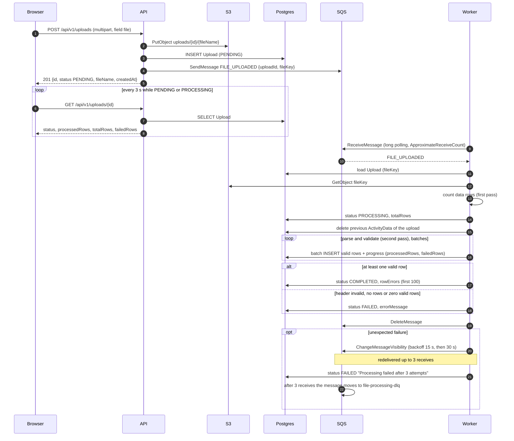

# CarbonBox · Procesamiento asíncrono de documentos

[](https://github.com/atarico/csv-ingestion-pipeline/actions/workflows/ci.yml)

## Descripción del proyecto

Sistema de procesamiento asíncrono de archivos CSV de datos de actividad (categoría,
cantidad, unidad, fecha) para la prueba técnica Full Stack de CarbonBox.

1. El usuario sube un CSV desde el frontend (Next.js).
2. La API (Fastify) guarda el archivo en S3, crea un registro `Upload` en PostgreSQL con
   estado `PENDING` y publica un mensaje en SQS. Responde `201`.
3. Un worker (proceso aparte, `npm run worker`) consume el mensaje, descarga el archivo,
   valida cada fila, guarda las filas válidas y deja el `Upload` en `COMPLETED` o `FAILED`.
4. El frontend consulta el estado cada 3 s mientras sea `PENDING` o `PROCESSING` y muestra
   el progreso, los resultados y los errores por fila.

El backend sigue DDD + Clean Architecture + CQRS, con un modelo de errores `Either` e
inyección de dependencias con Awilix. La infraestructura local (PostgreSQL y LocalStack
con S3 y SQS) corre con Docker Compose.

## Requisitos previos

- Node.js 24 (hay un `.nvmrc`) y npm 10 o superior.
- Docker con Compose v2.
- Puertos libres: 3000 (frontend), 4000 (API), 5432 (PostgreSQL) y 4566 (LocalStack).

## Instalación y ejecución

Todos los comandos se ejecutan desde la raíz del repositorio salvo que se indique otra
ruta.

### Opción A: infraestructura en Docker + apps locales

```bash
# 1. Infraestructura: PostgreSQL y LocalStack (crea bucket, cola y cola de mensajes fallidos)
docker compose up -d

# 2. API (terminal 1)
cd backend
npm ci
npm run prisma:migrate     # aplica las migraciones (prisma migrate deploy)
npm run prisma:generate    # genera el cliente de Prisma en src/generated/prisma
npm run dev                # API en http://localhost:4000

# 3. Worker (terminal 2)
cd backend
npm run worker

# 4. Frontend (terminal 3)
cd frontend
npm ci
npm run dev                # http://localhost:3000
```

El orden de `prisma:migrate` y `prisma:generate` importa poco entre sí, pero ambos deben
ejecutarse antes de `npm run dev`. `npm ci` no genera el cliente de Prisma.

### Opción B: todo en Docker

```bash
docker compose --profile app up --build
```

Levanta PostgreSQL, LocalStack, un servicio de migraciones (`migrate`, termina al acabar),
la API (`api`), el worker (`worker`) y el frontend (`frontend`). Abre
http://localhost:3000. Para detener solo los servicios de la aplicación y dejar la
infraestructura:

```bash
docker compose --profile app stop api worker frontend migrate
docker compose --profile app rm -f api worker frontend migrate
```

`docker compose --profile app down` detiene y elimina también PostgreSQL y LocalStack
(los volúmenes se conservan).

`NEXT_PUBLIC_API_URL` se incrusta en el frontend en tiempo de build y apunta a
`http://localhost:4000/api/v1`, porque es el navegador (en el host) quien llama a la API. Como queda fijado en la imagen,
cambiarla exige reconstruirla (`--build`, o `--build-arg NEXT_PUBLIC_API_URL=...`); reiniciar
el contenedor no basta.

### Variables de entorno

La API y el worker leen la configuración con Convict (validada al arrancar). Hay un
archivo por entorno en `backend/`: `.env.example` (plantilla), `.env.development`,
`.env.test` y `.env.docker` (usado por el perfil `app` de Compose). Son valores locales,
sin secretos reales. El archivo `.env` (no versionado) solo aporta variables que no estén
ya definidas; las variables del proceso tienen prioridad sobre ambos archivos.

| Variable | Default | Descripción |
|----------|---------|-------------|
| `NODE_ENV` | `development` | `development`, `test` o `production`; elige el archivo `.env.<NODE_ENV>` |
| `PORT` | `4000` | Puerto de la API |
| `HOST` | `0.0.0.0` | Interfaz de escucha |
| `LOG_LEVEL` | `info` | Nivel de pino |
| `DATABASE_URL` | (obligatoria) | Conexión a PostgreSQL |
| `AWS_REGION` | `us-east-1` | Región AWS |
| `AWS_ENDPOINT` | vacío | Endpoint de AWS; en local, LocalStack (`http://localhost:4566`) |
| `AWS_ACCESS_KEY_ID` / `AWS_SECRET_ACCESS_KEY` | vacío / vacío | Credenciales estáticas, opcionales y todo-o-nada (ambas o ninguna; si solo una está definida la configuración falla). En local, LocalStack acepta cualquier valor (`test` / `test`). En AWS déjalas vacías para usar el rol IAM de la tarea |
| `S3_BUCKET` | `document-processing` | Bucket de los CSV |
| `S3_FORCE_PATH_STYLE` | `true` | Necesario para LocalStack |
| `SQS_QUEUE_URL` | (obligatoria) | URL de la cola `file-processing` |
| `WORKER_WAIT_TIME_SECONDS` | `20` | Long polling del worker |
| `WORKER_VISIBILITY_TIMEOUT_SECONDS` | `60` | Visibility timeout al recibir |
| `WORKER_MAX_MESSAGES` | `1` | Mensajes por recepción |
| `WORKER_MAX_RECEIVE_COUNT` | `3` | Recepciones antes de declarar el fallo definitivo |
| `WORKER_POLL_BACKOFF_MAX_MS` | `30000` | Tope del backoff cuando la cola no responde |
| `WORKER_RETRY_BACKOFF_BASE_SECONDS` | `15` | Base del backoff por mensaje |
| `WORKER_RETRY_BACKOFF_MAX_SECONDS` | `60` | Tope del backoff por mensaje |
| `UPLOAD_MAX_FILE_SIZE_BYTES` | `5242880` | Tamaño máximo de subida (5 MiB) |
| `DEFAULT_USER_ID` | `user-123` | Usuario fijo (no hay autenticación) |
| `CORS_ORIGIN` | `http://localhost:3000` | Origen permitido por CORS |

Frontend: `NEXT_PUBLIC_API_URL` (default `http://localhost:4000/api/v1`) en
`frontend/.env.example` y `frontend/.env.development`.

### Scripts disponibles

Backend (`backend/`):

| Script | Descripción |
|--------|-------------|
| `npm run dev` | API con recarga (`tsx watch`) |
| `npm run worker` | Worker de procesamiento (proceso separado) |
| `npm run build` | Compila a `dist/` y copia el runtime del cliente de Prisma |
| `npm start` / `npm run worker:start` | API / worker compilados |
| `npm run lint` / `format` / `format:check` / `typecheck` | Calidad estática |
| `npm test` | Todas las pruebas (unitarias e integración) |
| `npm run test:unit` / `test:integration` / `test:coverage` | Subconjuntos y cobertura |
| `npm run prisma:generate` | Genera el cliente de Prisma |
| `npm run prisma:migrate` | Aplica las migraciones (`migrate deploy`) |
| `npm run prisma:migrate:new -- <nombre>` | Crea una migración (`migrate dev --name`) |
| `npm run prisma:studio` | Prisma Studio |

Frontend (`frontend/`):

| Script | Descripción |
|--------|-------------|
| `npm run dev` | Servidor de desarrollo de Next.js |
| `npm run build` / `npm start` | Build de producción / servidor |
| `npm run lint` / `npm run typecheck` | Calidad estática |
| `npm test` | Pruebas con Vitest y Testing Library |

## Arquitectura del sistema

### Diagrama de flujo



El mismo diagrama está en `docs/flujo.md`.

### Bounded context y capas

Hay un único bounded context, `document-processing`, con cuatro capas:

| Capa | Contenido | Puede importar |
|------|-----------|----------------|
| `domain` | Agregado `Upload`, entidades (`ActivityData`, `RowError`), value objects (`UploadStatus`, `FileName`, `Amount`, `Category`, `Unit`, `ActivityDate`), interfaces de repositorio | Solo `domain` y `shared/domain` |
| `application` | Commands y queries con sus handlers, DTOs, mappers, políticas, puertos (`ICsvParser`) | `domain`, `shared/domain`, `shared/application` (incluye los puertos `IFileStorage`, `IMessagePublisher`, `IMessageConsumer`, `ILogger`), `zod` |
| `infrastructure` | Repositorios Prisma, `S3FileStorage`, `SqsMessagePublisher`, `SqsMessageConsumer`, `CsvParseCsvParser`, módulo de Awilix | Todo |
| `presentation` | Controllers, rutas y esquemas zod de Fastify | `application`, `shared/*`, `fastify`, `zod` |

Regla de dependencias: `presentation → application → domain`, e `infrastructure`
implementa los puertos de `application` y las interfaces de repositorio de `domain`. La
capa de aplicación nunca importa infraestructura.

### Patrones

- **DDD.** Agregado `Upload` (raíz) con transiciones de estado (`PENDING → PROCESSING →
  COMPLETED/FAILED`), value objects inmutables que validan al construirse, repositorios
  definidos como interfaces en el dominio. Los IDs son UUID v4 generados en el dominio.
- **CQRS.** Cada caso de uso es un command o una query con su handler:

| Tipo | Objeto | Handler | Expuesto en |
|------|--------|---------|-------------|
| Command | `CreateUploadCommand` | `CreateUploadCommandHandler` | `POST /api/v1/uploads` |
| Command | `ProcessFileCommand` | `ProcessFileCommandHandler` | Worker |
| Query | `GetUploadByIdQuery` | `GetUploadByIdQueryHandler` | `GET /api/v1/uploads/:id` |
| Query | `ListUploadsQuery` | `ListUploadsQueryHandler` | `GET /api/v1/uploads` |
| Query | `GetUploadResultsQuery` | `GetUploadResultsQueryHandler` | `GET /api/v1/uploads/:id/results` |
| Query | `GetUploadStatsQuery` | `GetUploadStatsQueryHandler` | `GET /api/v1/uploads/stats` |

- **Either.** Todos los handlers devuelven `Promise<Either<DomainError, T>>`. Los errores
  de dominio y de validación viajan como `Left`; los controllers los traducen a HTTP con
  `BaseController.fail`. Las excepciones inesperadas llegan al `setErrorHandler` de Fastify.
  No hay `try/catch` en controllers ni handlers.
- **Inyección de dependencias.** Awilix en modo `CLASSIC` con singletons; los nombres de
  los parámetros del constructor coinciden con los nombres de registro.

### Estructura de carpetas

```
carbonbox-challenge/
├── backend/
│   ├── prisma.config.ts
│   └── src/
│       ├── config/                      # Convict: IConvictProps, loadConfig
│       ├── shared/
│       │   ├── domain/                  # Either, DomainError, Entity, AggregateRoot, UniqueId, Pagination
│       │   ├── application/             # ICommandHandler, IQueryHandler, ports/ (IFileStorage, IMessagePublisher, IMessageConsumer, ILogger)
│       │   └── infrastructure/          # aws, http (BaseController), logging, resilience, testing
│       ├── document-processing/
│       │   ├── domain/                  # entities, value-objects, repositories
│       │   ├── application/             # commands, queries, dtos, mappers, messages, policies, ports, services
│       │   ├── infrastructure/          # csv, messaging, persistence (schema.prisma, migrations), storage, dependency-injection
│       │   └── presentation/            # controllers, routes, schemas, http
│       ├── main/                        # App.ts, container.ts, index.ts (API)
│       ├── workers/                     # FileProcessingWorker, WorkerPolicy, index.ts
│       └── test/                        # helpers de pruebas de integración
├── frontend/src/
│   ├── app/                             # rutas: /, /uploads, /uploads/new, /uploads/[id]
│   ├── features/document-processing/    # api, components, lib, types
│   ├── shared/                          # components, lib
│   └── styles/
├── infra/                               # localstack/init-aws.sh, postgres/init.sql
├── samples/                             # CSV de ejemplo y generador
├── docs/                                # diagramas
└── docker-compose.yml
```

## Interfaz

La interfaz usa los tokens de marca observados en carbonbox.app: azul primario `#1620a4`,
verde de acento `#2f6b4a`, menta `#7ed3a8`, superficie oscura `#0d1230`, tipografía
Poppins, botones en forma de píldora y tarjetas con borde fino y sombra suave. Los tokens
están como variables CSS `--cb-*` (claro y oscuro) en `frontend/src/styles/globals.css` y se
exponen a Tailwind con `@theme inline`. El logo y los colores de CarbonBox son marcas de
CarbonBox y se usan solo dentro de esta entrega.

**Desviación de contraste.** El rojo de peligro del sitio (`#c0453f` sobre `#f7e4e3`) tiene
una relación de contraste de 4,12:1, por debajo del mínimo de 4,5:1 para texto. Aquí el texto
de error usa `#a83a35` (5,17:1 sobre el mismo fondo). Una prueba de contraste
(`tokens.test.ts`) comprueba los pares de colores de ambos temas.

**Tema claro y oscuro.** El botón del encabezado alterna el tema. La elección se guarda en
`localStorage` con la clave `carbonbox-theme`; si no hay nada guardado, se usa la preferencia
del sistema (`prefers-color-scheme`). Un script en línea en el `<head>` aplica el tema antes
del primer pintado, así que la página no parpadea con el tema equivocado. Si
`localStorage` no está disponible, el tema sigue la preferencia del sistema.

**Subida con confirmación.** Al elegir un archivo aparece una tarjeta con su nombre y tamaño
(y la opción "Cambiar archivo"). `Subir` no sube nada todavía: abre el diálogo
"¿Procesar el archivo?" con los botones `Sí, procesar` y `Cancelar`. Un archivo vacío (0
bytes) se rechaza en el cliente antes de llegar a ese paso.

**Aviso de archivo subido.** Tras confirmar, el detalle del upload muestra un aviso: "El
archivo se subió correctamente. El procesamiento empieza en segundos y esta página se
actualiza sola." Se muestra una sola vez por subida (una marca en `sessionStorage`).

**Errores explicados.** Cuando un upload falla o una fila se rechaza, la interfaz explica en
español qué ocurrió y cómo corregirlo a partir de los códigos de la API (ver "Códigos de
error" más abajo).

## Decisiones técnicas

### Decisiones ante ambigüedades del enunciado

| # | Enunciado | Problema | Decisión |
|---|-----------|----------|----------|
| 1 | "Mock simple" de la cola con un array en memoria y `npm run worker` como script aparte | Dos procesos no comparten memoria: el worker nunca recibiría el mensaje | SQS real mediante `@aws-sdk/client-sqs` detrás de un puerto; SQS y S3 locales con LocalStack; el worker es un proceso separado |
| 2 | El worker pone `COMPLETED` o `FAILED` y el frontend consulta "mientras status = PROCESSING" | Un upload nuevo está en `PENDING`, así que la consulta nunca empezaría, y `PROCESSING` nunca se asignaría | El worker pone `PROCESSING` al empezar un archivo; el frontend consulta cada 3 s mientras el estado sea `PENDING` o `PROCESSING` |
| 3 | Flujo: 3) encolar mensaje, 4) crear registro en BD | El worker podría recibir el mensaje antes de que exista el registro | Orden: guardar archivo, crear registro (`PENDING`), publicar mensaje, responder `201` |
| 4 | "Guardar filas válidas" y el esquema tiene `failedRows`, sin regla para fallos parciales | No está definido cuándo un upload es `COMPLETED` o `FAILED` | Las filas válidas se guardan, las inválidas se cuentan en `failedRows` y los primeros 100 errores se guardan en `rowErrors`; `COMPLETED` si hay al menos una fila válida; `FAILED` si el archivo no se puede leer, la cabecera es inválida, no hay filas de datos o ninguna fila es válida |
| 5 | CQRS, Either y Docker Compose como "si hay tiempo"; luego "Either obligatorio" y arquitectura con 30 puntos | Prioridad contradictoria | DDD, CQRS, Either, Docker Compose e inyección de dependencias son obligatorios en esta implementación |
| 6 | "Devolver Either" y "sin try/catch en controllers, que los errores suban a un middleware" | Con Either los errores no suben; además Fastify no tiene middleware para esto | Los errores de dominio y validación viajan como `Left<DomainError>` y los controllers los mapean a HTTP; las excepciones inesperadas llegan a `setErrorHandler`; no hay `try/catch` en controllers ni handlers |
| 7 | `IMessagePublisher`/`IMessageConsumer` en `shared/infrastructure/messaging` y sin interfaz de almacenamiento | La capa de aplicación dependería de infraestructura, rompiendo la regla de dependencias | Los puertos `IFileStorage`, `IMessagePublisher`, `IMessageConsumer` e `ILogger` viven en `shared/application/ports/`; `ICsvParser` en `document-processing/application/ports/`; los adaptadores (S3, SQS, pino, `csv-parse`) están en infraestructura |
| 8 | El dashboard necesita totales por estado; `GetUploadResultsQuery` y `/results` aparecen en el listado pero faltan en el árbol | No hay endpoint para el dashboard y faltan archivos | Se añade `GET /api/v1/uploads/stats` con `GetUploadStatsQuery`, y `GetUploadResultsQuery` con su handler y controller |
| 9 | `docker-compose.yml` en `backend/` y en la raíz; el README hace `cd backend` y luego `cd frontend`; esquema de Prisma en una ruta no estándar | Las instrucciones no funcionan tal cual | `docker-compose.yml` en la raíz; rutas del README corregidas; la ruta del esquema de Prisma se configura en `backend/prisma.config.ts` |

### Desviaciones deliberadas respecto del enunciado

- `FileProcessingService.ts` no se creó: su responsabilidad es `ProcessFileCommandHandler`.
- `ICommandBus` e `IQueryBus` no se implementaron: cada controller llama directamente a
  un handler tipado, que ya devuelve `Either`. Un bus genérico añadiría una capa de
  indirección sin comportamiento (no hay middlewares de bus ni colas internas) y perdería
  el tipado fuerte de entrada y salida por caso de uso.
- Esquema de Prisma: `fileUrl` pasa a `fileKey`; `status String` pasa a `enum
  UploadStatus`; `amount Float` pasa a `Decimal(14, 4)`; `date DateTime` pasa a `@db.Date`.
- Se añadieron `Upload.rowErrors Json?`, `ActivityData.rowNumber Int` con
  `@@unique([uploadId, rowNumber])` e índices.
- `GET /api/v1/uploads/:id/results` responde paginado (`page` y `limit`, por defecto 100 y
  máximo 500) y cada fila incluye además `id` y `rowNumber`; el enunciado muestra un
  `{ data: [...] }` sin paginar. Con archivos de 50 000 filas una sola respuesta no es
  razonable, y la tabla del detalle pagina de a 100.
- `CsvParserService.ts` no se creó: lo reemplazan el puerto `ICsvParser`, el adaptador
  `CsvParseCsvParser` y la política `CsvHeaderPolicy`.
- `postgres:18-alpine` en lugar de `postgres:15-alpine` (la versión con soporte actual; ver
  en `USO-DE-IA.md` el ajuste de la ruta del volumen). La clave `version` de Compose se omite
  porque Compose v2 la ignora.
- No hay `backend/README.md` ni `frontend/README.md`: toda la documentación está en este
  archivo. El frontend usa `next.config.ts` en lugar de `next.config.js`, y Tailwind 4 no
  usa `tailwind.config.ts`: los tokens se declaran en CSS con `@theme`.

### Otras decisiones y trade-offs

- **Sin CommandBus.** Ver arriba: menos indirección, controllers acoplados a handlers
  concretos (inyectados).
- **`Decimal(14, 4)` y `DATE`.** `Float` pierde precisión con valores monetarios o de
  emisiones; `DATE` evita problemas de zona horaria al ser una fecha sin hora. Todo el
  cálculo de fechas es en UTC.
- **`fileKey` en lugar de `fileUrl`.** Se guarda la clave del objeto, no una URL: la URL
  depende del entorno (LocalStack o AWS) y el handler lee la clave de la base de datos.
- **Dos pasadas sobre el CSV.** La primera cuenta las filas (para `totalRows` y la barra de
  progreso); la segunda valida e inserta por lotes. Cuesta una lectura más a cambio de un
  progreso real.
- **Reprocesamiento idempotente.** Antes de insertar, el worker borra las filas previas del
  upload (`deleteByUploadId`); `@@unique([uploadId, rowNumber])` impide duplicados.
- **Política de reintentos.** Backoff exponencial por mensaje con `ChangeMessageVisibility`
  (15 s, luego 30 s, más hasta 15 s de jitter) y cola de mensajes fallidos (DLQ) tras 3
  recepciones. Además, el polling del worker aplica backoff cuando la cola no responde.
- **LocalStack fijado en 4.14.0.** Es la última versión que funciona sin token de
  autenticación; `latest` lo exige desde la versión 2026.03.
- **`csv-parse` detrás del puerto `ICsvParser`.** La aplicación no conoce la librería; se
  puede sustituir sin tocar los handlers.
- **Convict** valida la configuración al arrancar y falla rápido; **zod** valida la
  entrada de transporte en los controllers; **Vitest** para pruebas unitarias y de
  integración.
- **Credenciales de AWS.** En local se usan claves estáticas (`AWS_ACCESS_KEY_ID` /
  `AWS_SECRET_ACCESS_KEY`, `test` / `test` en LocalStack). En AWS se dejan vacías y el SDK
  usa la cadena de credenciales por defecto (el rol IAM de la tarea), sin secretos en la
  configuración. Las dos claves son todo-o-nada: definir solo una hace fallar el arranque.
- **Paginación determinista.** El listado de uploads se ordena por `createdAt` descendente
  con `id` descendente como desempate, para que dos uploads con la misma marca de tiempo no
  salten ni se repitan entre páginas.
- **Parada ordenada.** El long polling y la espera del backoff del worker se pueden
  cancelar, y Compose define `stop_grace_period`; así `docker compose stop` termina el
  worker en menos de un segundo en lugar de esperar la recepción en curso.
- **Poppins autoalojada.** Se usa `@fontsource/poppins` (versión exacta 5.3.0) en lugar de
  `next/font/google`: este último descarga la fuente de Google en el build, y el build de la
  imagen Docker no debe depender de la red.
- **Tema propio en lugar de `next-themes`.** Son cuatro archivos pequeños (`frontend/src/shared/theme/`)
  y evitan una dependencia. El estado vive en el atributo `data-theme` de `<html>`, que el
  script en línea fija antes del primer pintado; `ThemeProvider` lo lee con
  `useSyncExternalStore` (el servidor devuelve `light` y el cliente lee el DOM, sin
  desajuste de hidratación ni `setState` en un efecto) y un `MutationObserver` mantiene el
  estado al día si el atributo cambia.
- **La API sigue en inglés, con códigos legibles por máquina; la interfaz explica en
  español.** Los mensajes de la API no cambian. Cada fallo añade un código estable
  (`errorCode`, `rowErrors[].code`) y la interfaz decide el texto en español y la
  corrección sugerida. Los códigos viven en el dominio (`FieldErrorCode` en
  `shared/domain/DomainError.ts`, `UploadFailureCode` en `Upload.ts`) porque son parte del
  lenguaje del negocio: los value objects los emiten al validar, así que ningún adaptador
  tiene que interpretar mensajes en texto.
- **Sin retrasos artificiales.** El código de producción no tiene `sleep` para hacer
  visible `PROCESSING`; para observarlo se usa el archivo grande de `samples/`.

### Limitaciones conocidas

Estado real de lo que no está completo o no se pudo comprobar:

- **Adaptadores AWS sin pruebas unitarias.** `S3FileStorage`, `SqsMessagePublisher` y
  `SqsMessageConsumer` no tienen pruebas unitarias. Los ejercitan las pruebas E2E (job
  `e2e` de CI, que levanta el stack completo con LocalStack) y la lista de humo manual; la
  ruta de apagado del consumidor SQS (cancelar el long polling) solo se cubre con la prueba
  manual de `docker compose stop worker`. Futuro: `aws-sdk-client-mock`.
- **Un solo usuario, sin autenticación** (`DEFAULT_USER_ID=user-123`), como permite el
  enunciado.
- **Varios workers pueden reprocesar el mismo upload.** No hay versión optimista ni
  heartbeat de visibilidad: con varios workers, un archivo que tarde más que el visibility
  timeout (60 s) vuelve a ser visible y otro worker puede recibirlo, con lo que se procesa
  dos veces, y un guardado tardío del estado `PROCESSING` podría pisar un `COMPLETED`. `deleteByUploadId` y
  `@@unique([uploadId, rowNumber])` mantienen los datos correctos, pero el trabajo se
  repite. Solución prevista: columna `version` con actualización condicional y heartbeat con
  `ChangeMessageVisibility`.
- **Un mensaje reenviado desde la DLQ se descarta.** Tras la tercera recepción el upload ya
  está en `FAILED` (estado terminal), así que reenviar el mensaje desde la DLQ no lo
  reprocesa. Camino de operador hoy: devolver el upload a `PENDING` con SQL manual antes del
  redrive. Futuro: un consumidor de DLQ o un endpoint de administración.
- **`WORKER_MAX_RECEIVE_COUNT` debe coincidir con la cola.** El valor (3) tiene que ser
  igual al `maxReceiveCount` de la `RedrivePolicy` de la cola (`infra/localstack/init-aws.sh`).
  Si el worker usa un valor mayor, SQS mueve el mensaje a la DLQ antes de que el upload se
  marque `FAILED` y puede quedar en `PROCESSING`. No se valida al arrancar.
- **Upload en `PROCESSING` tras un crash en la tercera recepción.** Si el worker muere en
  la tercera recepción de un mensaje, el upload puede quedar en `PROCESSING` con su mensaje
  en la DLQ. La recuperación es un redrive manual o un consumidor de DLQ futuro que lo
  marque `FAILED`.
- **Archivo huérfano en S3.** Si la creación del registro falla después de subir el
  archivo, el objeto queda en S3 sin registro (no hay limpieza compensatoria). Futuro:
  outbox transaccional y reglas de ciclo de vida de S3.
- **Número de fila en los errores.** El campo `row` de cada error es el índice del registro
  de datos (sin contar la cabecera y saltando las líneas en blanco), no el número de línea
  físico del archivo.
- **Mensajes de la API en inglés.** Los campos `message` y `errorMessage` (por ejemplo
  `Invalid CSV header: missing [date]`) están en inglés a propósito, como parte del
  contrato de la API. La interfaz no los muestra tal cual: usa los códigos para explicar el
  problema en español, y conserva el texto en inglés como detalle cuando el código no
  alcanza para explicarlo (`MALFORMED_CSV`, `ENQUEUE_FAILED`, `PROCESSING_ERROR`) o falta
  (registros antiguos).
- **`value` truncado a 50 caracteres.** El valor de la celda en `rowErrors[].value` se
  recorta y termina en `…` si pasa de 50; los caracteres de control se guardan como `�`
  (PostgreSQL `jsonb` rechaza `\u0000`). No es el contenido completo de la celda.
- **El aviso "archivo subido" puede ser impreciso.** Dice que el procesamiento empieza en
  segundos aunque un archivo muy pequeño ya haya terminado, o fallado, cuando carga la
  página; el estado real se muestra justo debajo.
- **Apagado.** Con `docker compose stop` el worker termina en menos de un segundo (medido:
  0,3 s, código de salida 0), porque la espera de la recepción en curso se cancela; los
  servicios tienen `stop_grace_period` (30 s el worker, 15 s la API). La API no tiene un
  tiempo máximo propio de cierre. `npm run worker` informa código de salida 130 cuando se
  interrumpe el grupo de procesos, aunque el proceso de node termina con 0.
- **Auditoría de dependencias.** `npm audit` (ejecutado sin aplicar correcciones):
  - Frontend: `npm audit --omit=dev` encuentra 0 vulnerabilidades; `npm audit` completo
    encuentra 5 de severidad alta (`braces`, `micromatch`, `fast-glob`,
    `@next/eslint-plugin-next`, `eslint-config-next`), todas de desarrollo (la cadena de
    ESLint del scaffold), sin llegar al runtime.
  - Backend: `npm audit --omit=dev` y `npm audit` coinciden: 8 de severidad alta. La
    cadena `awilix` → `fast-glob` → `micromatch` → `braces` (denegación de servicio por
    patrones anidados) es de producción, pero la aplicación no pasa entrada de usuario a
    esas librerías. `prisma` (declarado como dependencia de desarrollo; npm lo cuenta por
    el cliente) arrastra `mysql2` y `deepmerge-ts`; `mysql2` no se usa porque la aplicación
    solo habla con PostgreSQL. La corrección que propone npm es un cambio mayor
    (`prisma@6`) y no se aplicó.
- **No incluido en esta entrega** (sin impacto de usuario): eliminar el índice
  `@@index([uploadId])`, redundante con el `@@unique`; normalizar `Amount`; limitar el rango
  de años de `ActivityDate`; un endpoint `/ready`; políticas `restart` en Compose y fijar
  imágenes por digest.
- **`docker compose --profile app down`** elimina también PostgreSQL y LocalStack; se
  documenta `stop` + `rm` para bajar solo la aplicación.
- **`next dev` genera `frontend/AGENTS.md`** (Next.js 16.4); se añadió a
  `frontend/.gitignore`.
- **URLs de cola de LocalStack.** LocalStack 4.14.0 devuelve las colas con el host
  `localhost.localstack.cloud`; los archivos de entorno usan `localhost:4566`, que
  funciona desde el host.
- **Observabilidad del arranque.** El log de la API lista cada interfaz de red
  (`Server listening at http://<ip>:4000`) en lugar de una sola línea `0.0.0.0`.

## Cómo probarlo

### URLs

| Servicio | URL |
|----------|-----|
| Frontend | http://localhost:3000 |
| API | http://localhost:4000/api/v1 |
| Health | http://localhost:4000/health |
| LocalStack | http://localhost:4566 |

### Paso a paso con el CSV de ejemplo

1. Levanta todo (opción A o B). Con una base de datos nueva, el dashboard muestra ceros.
2. Abre http://localhost:3000/uploads/new y elige `sample-data.csv` (arrastrar y soltar o
   selector; solo se aceptan archivos `.csv`). Aparece la tarjeta con el nombre y el
   tamaño; pulsa `Subir` y confirma en el diálogo "¿Procesar el archivo?" con `Sí, procesar`.
3. Se redirige al detalle del upload, con el aviso de archivo subido. Con 60 filas, `Pendiente` y `Procesando` duran
   milisegundos y normalmente no se ven: el estado pasa a `Completado` en pocos segundos y
   aparecen las 60 filas en una sola página.
4. En el log del worker aparece `Upload processed` con `processedRows: 60`.
5. Sube `samples/sample-with-errors.csv`: `Completado`, `Filas con errores: 6` y la tabla
   de errores con las filas 3, 7, 11, 15, 19 y 23, cada una con el valor ofensivo y una
   explicación (por ejemplo, fila 3: «-12.5» no es un número válido).
6. Sube `samples/invalid-header.csv`: `Fallido` con el título "La primera fila del archivo
   no tiene las columnas esperadas", la línea `Faltan: date` y un enlace para descargar un
   CSV de ejemplo.

### Qué observar durante el procesamiento

- Badges de estado: `Pendiente`, `Procesando` (con barra de progreso), `Completado`
  (verde) y `Fallido` (rojo).
- El log del worker (JSON estructurado con pino): `Processing file`, `Processing started`,
  `File processed` y `Upload processed`.
- Con 60 filas el estado `Procesando` dura milisegundos; para verlo, usa el archivo grande.

### Observar el estado Procesando con un archivo grande

```bash
node samples/generate-large-sample.mjs
```

Sube `samples/large-sample.csv` (50 000 filas). El detalle muestra `Procesando X de 50000
filas` con la barra avanzando; el frontend consulta cada 3 s y se detiene al llegar a
`Completado`. En la prueba local el procesamiento duró unos 11 s y el navegador vio 11 500,
26 500 y 40 500 filas procesadas en tres consultas consecutivas. No hay retrasos
artificiales en el código: el tiempo lo da el volumen de datos.

### Casos de error y DLQ

Resultados de la lista de humo ejecutada una vez contra LocalStack:

| Paso | Procedimiento | Resultado observado |
|------|---------------|---------------------|
| 8 | Detener el worker, subir `sample-data.csv` con curl, borrar el objeto en S3 (`docker compose exec localstack awslocal s3 rm s3://document-processing/uploads/<id>/sample-data.csv`) y arrancar el worker | El worker registró `Processing failed, will retry` con `retryInSeconds` 16 y luego 32, y después `Message dead-lettered`. El upload quedó `FAILED` con `Processing failed after 3 attempts: Could not download ...` (unos 50 s tras arrancar el worker). El mensaje apareció en `file-processing-dlq` unos 60 s después (el visibility timeout de la tercera recepción) |
| 9 | Detener LocalStack con el worker en marcha | El worker registró `Receive failed, backing off` con `delayMs` creciente (885, 1777, 3430, 7303, 13772, 18372). Al reiniciar LocalStack volvió a procesar sin reiniciar el worker (un upload nuevo quedó `COMPLETED`) |
| 10 | Ctrl+C al worker durante el long polling | Registró `Shutting down worker` (señal `SIGINT`) y terminó tras unos 21 s (medición anterior a cancelar la espera al apagar; ahora `docker compose stop worker` tarda 0,3 s) |

Para reproducir el paso 8, el mensaje se mira con:

```bash
docker compose exec localstack awslocal sqs receive-message \
  --queue-url http://localhost:4566/000000000000/file-processing-dlq --wait-time-seconds 3
```

El handler lee `fileKey` de la base de datos, así que un mensaje falsificado no sirve para
forzar un fallo; borrar el objeto de S3 es el procedimiento admitido.

### Ejemplos con curl

La petición de subida debe contener exactamente una parte multipart, el archivo en el campo `file`; cualquier otra parte (un segundo archivo o un campo de texto) devuelve 400.

```bash
# Subir un archivo (campo multipart "file")
curl -s -F "file=@sample-data.csv" http://localhost:4000/api/v1/uploads
# {"id":"<uuid>","status":"PENDING","fileName":"sample-data.csv","createdAt":"..."}

# Estado de un upload
curl -s http://localhost:4000/api/v1/uploads/<id>

# Listado paginado
curl -s "http://localhost:4000/api/v1/uploads?page=1&limit=10"

# Filas procesadas (limit por defecto 100, máximo 500)
curl -s "http://localhost:4000/api/v1/uploads/<id>/results?page=1&limit=100"

# Totales por estado (dashboard)
curl -s http://localhost:4000/api/v1/uploads/stats

# Salud
curl -s http://localhost:4000/health
```

Los errores tienen la forma `{"error":{"code","message","details?"},"requestId"}`.

### Códigos de error

Los cambios de esta ronda son aditivos: no se quitó ni cambió ningún campo existente, así
que los clientes anteriores siguen funcionando. `GET /api/v1/uploads/:id` añade:

| Campo | Contenido |
|-------|-----------|
| `errorCode` | Código de `UploadFailureCode` si el upload está `FAILED`; `null` en otro caso |
| `errorDetails` | Datos estructurados del fallo (objeto) o `null`; con `INVALID_HEADER`: `expected`, `missing`, `unexpected`, `duplicated`; con `MALFORMED_CSV`: `reason` |
| `rowErrors[].code` | Código de `FieldErrorCode`, o `INVALID` |
| `rowErrors[].value` | Celda ofensiva, recortada, hasta 50 caracteres más `…`; se omite si la celda está vacía |

`UploadFailureCode` (`errorCode`):

| Código | Cuándo ocurre |
|--------|---------------|
| `INVALID_HEADER` | La cabecera no tiene exactamente `category,amount,unit,date` |
| `EMPTY_FILE` | El archivo está vacío |
| `MALFORMED_CSV` | El archivo no se puede leer como CSV |
| `NO_DATA_ROWS` | Solo hay fila de cabecera |
| `NO_VALID_ROWS` | Ninguna fila es válida |
| `ENQUEUE_FAILED` | No se pudo encolar el archivo para procesarlo |
| `PROCESSING_ERROR` | Fallo al procesar, por ejemplo tras agotar los reintentos del worker |

`FieldErrorCode` (`rowErrors[].code`):

| Código | Cuándo ocurre |
|--------|---------------|
| `REQUIRED` | La celda está vacía o falta la columna |
| `INVALID_NUMBER` | `amount` no es un número positivo con hasta 4 decimales (incluye los negativos) |
| `NOT_POSITIVE` | `amount` es 0 |
| `TOO_LONG` | El texto supera el máximo (`category` 100, `unit` 20) |
| `CONTROL_CHARACTERS` | La celda contiene caracteres de control |
| `INVALID_DATE_FORMAT` | `date` no tiene el formato `AAAA-MM-DD` |
| `INVALID_DATE` | `date` no es una fecha real del calendario |
| `INVALID` | Valor de reserva: los registros guardados antes de esta ronda no tienen código y se cargan con `INVALID` |

## Testing

| Suite | Comando | Resultado verificado |
|-------|---------|----------------------|
| Backend, todo | `cd backend && npm test` | 247 pruebas (202 unitarias y 45 de integración) |
| Backend, unitarias | `npm run test:unit` | 202 pruebas; sin infraestructura |
| Backend, integración | `npm run test:integration` | 45 pruebas; necesitan PostgreSQL (`docker compose up -d`); usan una base `document_processing_test` y no tocan S3 ni SQS |
| Frontend | `cd frontend && npm test` | 146 pruebas |
| Cobertura | `npm run test:coverage` | líneas: global 86,31 % |

Las pruebas se escribieron antes que el código en cada capa. Los adaptadores de S3 y SQS no
tienen pruebas unitarias (ver "Limitaciones conocidas").

### Pruebas E2E

El paquete independiente `e2e/` contiene pruebas de navegador (Playwright, solo Chromium)
que usan únicamente la interfaz: no importan código de la aplicación. Necesitan el stack
completo en marcha:

```bash
docker compose --profile app up -d --build --wait
cd e2e
npm ci
npx playwright install chromium   # solo la primera vez
npm test                          # E2E_BASE_URL cambia la URL (por defecto http://localhost:3000)
```

Cada prueba sube el archivo con un nombre único, así que no depende de las filas que ya
existan en la base. Cubren: el CSV válido (`sample-data.csv`, 60 filas) hasta
"Completado" y su aparición en la lista; `samples/sample-with-errors.csv` (19 filas
válidas, 6 con error, errores por fila visibles y la explicación de la fila 3,
«-12.5» no es un número válido); `samples/invalid-header.csv` ("Fallido" con la
explicación de la cabecera y `Faltan: date`); y el rechazo en el cliente de un archivo que
no es `.csv`. Una quinta prueba (`theme.spec.ts`) comprueba que el tema sigue al sistema,
se alterna, persiste al recargar y deja visibles las insignias de estado. Las pruebas de
subida confirman en el diálogo antes de procesar. El informe HTML se genera siempre en `e2e/playwright-report/`;
CI solo lo sube como artefacto cuando las pruebas fallan.

Estas cinco pruebas (cuatro de subida y una de tema) son la evidencia automática del comportamiento de la interfaz en
Chromium. Antes de la entrega, el candidato la verifica además a mano en un navegador de
escritorio.

CI: el workflow `.github/workflows/ci.yml` define un job `backend` (generate, lint,
typecheck, unitarias, integración con PostgreSQL, build), un job `frontend` (lint,
typecheck, pruebas, build) y un job `e2e` (levanta el stack con Compose y ejecuta Playwright).
Todas las ejecuciones en GitHub Actions sobre `main` han terminado en verde en los tres jobs,
desde la primera, [38084387707](https://github.com/atarico/csv-ingestion-pipeline/actions/runs/38084387707),
hasta la más reciente al escribir esto,
[38291158893](https://github.com/atarico/csv-ingestion-pipeline/actions/runs/38291158893).

## Diagrama de infraestructura AWS

Arquitectura objetivo en AWS (VPC, ALB, ECS Fargate, RDS, S3, SQS con DLQ, CloudWatch y
Secrets Manager). Detalle en [docs/arquitectura-aws.md](docs/arquitectura-aws.md).


## Uso de IA

Ver [USO-DE-IA.md](USO-DE-IA.md).
