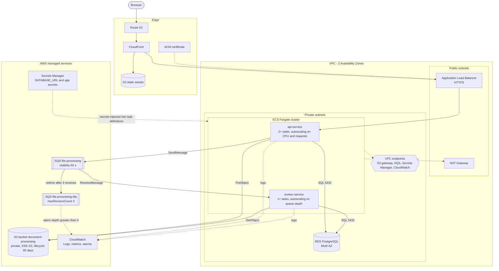

# AWS target architecture

Production-oriented deployment of the same system that runs locally on Docker Compose
(PostgreSQL + LocalStack). Nothing here is deployed by this repository; it documents how
the components map to AWS services.



The diagram source is `docs/arquitectura-aws.mmd`; `docs/arquitectura-aws.png` is rendered
from it with `minlag/mermaid-cli` (see the command at the end of this file).

## Components

| Component | Purpose | Why |
|-----------|---------|-----|
| Route 53 | DNS for the public domain | Optional; keeps the entry point independent from the load balancer |
| CloudFront + S3 static | Serves the frontend assets (or an ECS task if SSR is needed) | Cache close to users; no servers to run for static assets |
| ACM | TLS certificate for CloudFront and the ALB | Free managed certificates with automatic renewal |
| ALB (public subnets) | HTTPS entry point, forwards `/api/*` to the API target group | Health checks and zero-downtime deployments |
| NAT Gateway (public subnets) | Outbound internet for private tasks | Only for traffic that cannot use VPC endpoints |
| ECS Fargate `api-service` | Fastify API, 2+ tasks across two AZs, autoscaling on CPU and requests | Stateless, horizontally scalable, no host management |
| ECS Fargate `worker-service` | CSV worker, 1+ tasks, autoscaling on SQS `ApproximateNumberOfMessagesVisible` | Scales with the backlog, independent from API traffic |
| RDS PostgreSQL Multi-AZ | `Upload` and `ActivityData` | Automatic failover; private subnets; the security group accepts only the ECS security group on 5432 |
| S3 bucket `document-processing` | Uploaded CSV files | Private, block public access, SSE-S3, lifecycle expires `uploads/` after 90 days and aborts incomplete multipart uploads |
| SQS `file-processing` | Upload messages, visibility timeout 60 s | Decouples the API from the processing time |
| SQS `file-processing-dlq` | Dead-letter queue, `maxReceiveCount` 3 | Keeps messages that failed three times for inspection or redrive |
| CloudWatch | Logs of API and worker, metrics, alarms (5xx, DLQ depth greater than 0, oldest message age) | Operational visibility and alerting |
| Secrets Manager | `DATABASE_URL` and application secrets injected into the task definitions | No secrets in images or environment files |
| IAM task roles | S3 `GetObject`/`PutObject` on the bucket; SQS `SendMessage`/`ReceiveMessage`/`DeleteMessage` on the queue | Least privilege per service |
| VPC endpoints | Gateway endpoint for S3; interface endpoints for SQS, Secrets Manager and CloudWatch | Private tasks reach AWS services without crossing the NAT |

## Request path

Browser → CloudFront → ALB (HTTPS) → `api-service` task → S3 (store file) → RDS (insert
`PENDING` upload) → SQS (publish message) → `201` response. The browser then polls
`GET /api/v1/uploads/:id` every 3 s while the status is `PENDING` or `PROCESSING`.

## Processing path

SQS → `worker-service` task (long polling) → S3 (download) → RDS (status `PROCESSING`,
batch insert of valid rows, progress, final status) → SQS (delete message).

## Scaling and failure notes

- API and worker are stateless and scale independently; the worker scales on queue depth.
- RDS Multi-AZ fails over automatically; ECS replaces unhealthy tasks across AZs.
- A message is received up to 3 times (visibility timeout 60 s, per-message backoff of
  15 s then 30 s through `ChangeMessageVisibility`); after that SQS moves it to the DLQ and
  the CloudWatch alarm on DLQ depth fires. Reprocessing is idempotent (previous rows of the
  upload are deleted and `@@unique([uploadId, rowNumber])` guards duplicates).
- With several workers, a file that takes longer than the visibility timeout plus the retry
  delay could be processed twice; a visibility heartbeat is future work (see README).

## Cost note

Fargate Spot is an option for `worker-service`: interrupted tasks leave the message in the
queue and it is redelivered. Interface VPC endpoints have an hourly cost that should be
compared with the NAT Gateway traffic they replace.

## Rendering the PNG

```bash
docker run --rm -u "$(id -u):$(id -g)" -v "$PWD/docs:/data" minlag/mermaid-cli \
  -i /data/arquitectura-aws.mmd -o /data/arquitectura-aws.png -b white -s 2
```

The `-w 1600` option from older `mermaid-cli` releases no longer exists in the current
image; `-s 2` (scale factor) is used instead.
