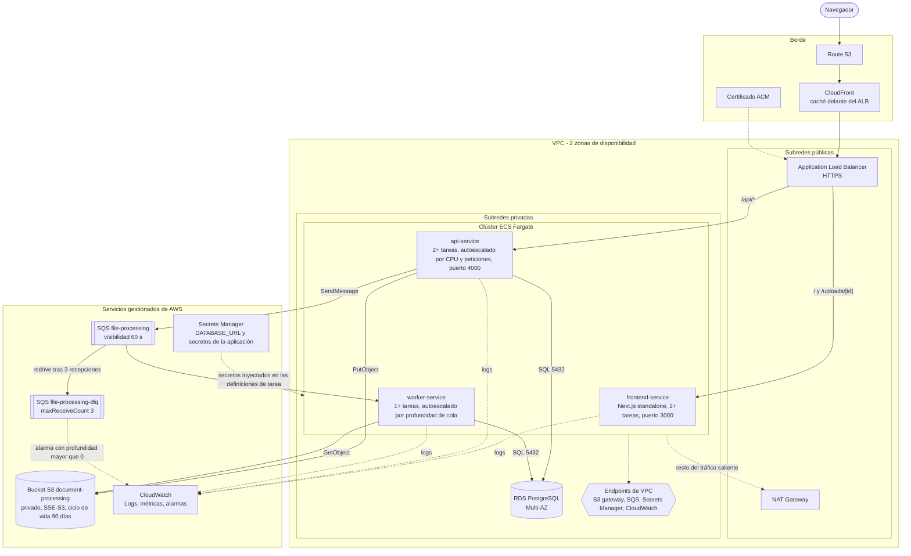

# Arquitectura objetivo en AWS

Despliegue orientado a producción del mismo sistema que se ejecuta en local con Docker
Compose (PostgreSQL + LocalStack). Este repositorio no despliega nada de esto; documenta cómo
se corresponden los componentes con los servicios de AWS.



El origen del diagrama es `docs/arquitectura-aws.mmd`; `docs/arquitectura-aws.png` se genera
a partir de él con `minlag/mermaid-cli` (ver el comando al final de este archivo).

## Componentes

| Componente | Propósito | Motivo |
|------------|-----------|--------|
| Route 53 | DNS del dominio público | Opcional; mantiene el punto de entrada independiente del balanceador |
| CloudFront | Caché delante del ALB para las respuestas del frontend y los recursos estáticos de `/_next/static` | Caché cercana al usuario; el origen sigue siendo el ALB |
| ACM | Certificado TLS para CloudFront y el ALB | Certificados gestionados gratuitos con renovación automática |
| ALB (subredes públicas) | Punto de entrada HTTPS; reenvía `/api/*` al grupo de destino de la API y el resto al del frontend | Health checks y despliegues sin interrupción |
| NAT Gateway (subredes públicas) | Salida a Internet de las tareas privadas | Solo para el tráfico que no puede usar endpoints de VPC |
| ECS Fargate `frontend-service` | Servidor Next.js (`output: 'standalone'`, puerto 3000) con la ruta dinámica `/uploads/[id]`, 2+ tareas en dos zonas | El build no es un sitio estático, así que necesita un servidor; sin estado y escalable horizontalmente |
| ECS Fargate `api-service` | API Fastify (puerto 4000), 2+ tareas en dos zonas, autoescalado por CPU y peticiones | Sin estado, escalable horizontalmente, sin gestión de servidores |
| ECS Fargate `worker-service` | Worker de CSV, 1+ tareas, autoescalado por `ApproximateNumberOfMessagesVisible` de SQS | Escala con la cola, independiente del tráfico de la API |
| RDS PostgreSQL Multi-AZ | `Upload` y `ActivityData` | Conmutación automática; subredes privadas; el security group solo acepta el de API y worker en el puerto 5432 |
| Bucket S3 `document-processing` | Archivos CSV subidos | Privado, acceso público bloqueado, SSE-S3, el ciclo de vida expira `uploads/` a los 90 días y aborta las cargas multiparte incompletas |
| SQS `file-processing` | Mensajes de subida, visibility timeout de 60 s | Desacopla la API del tiempo de procesamiento |
| SQS `file-processing-dlq` | Cola de mensajes fallidos, `maxReceiveCount` 3 | Conserva los mensajes que fallaron tres veces para inspeccionarlos o reencolarlos |
| CloudWatch | Logs del frontend, la API y el worker, métricas, alarmas (5xx, profundidad de la DLQ mayor que 0, antigüedad del mensaje más viejo) | Visibilidad operativa y alertas |
| Secrets Manager | `DATABASE_URL` y secretos de la aplicación inyectados en las definiciones de tarea | Sin secretos en imágenes ni en archivos de entorno |
| Roles de tarea IAM | API: S3 `PutObject` sobre el bucket y SQS `SendMessage` sobre la cola. Worker: S3 `GetObject` sobre el bucket y SQS `ReceiveMessage`, `DeleteMessage` y `ChangeMessageVisibility` sobre la cola | Mínimo privilegio por servicio; los reintentos dependen de `ChangeMessageVisibility` |
| Endpoints de VPC | Endpoint gateway para S3; endpoints de interfaz para SQS, Secrets Manager y CloudWatch | Las tareas privadas llegan a los servicios de AWS sin pasar por el NAT |
| Security groups | ALB: 443 desde Internet; frontend: 3000 solo desde el ALB; API: 4000 solo desde el ALB; worker: sin entrada; RDS: 5432 solo desde API y worker; endpoints de interfaz: 443 desde API y worker | Mínimo privilegio en red |

## Ruta de una petición

Navegador → CloudFront → ALB (HTTPS) → tarea de `frontend-service` (páginas, incluida
`/uploads/[id]`). Para subir un archivo, el navegador llama a `/api/*`: ALB → tarea de
`api-service` → S3 (guarda el archivo) → RDS (inserta la subida `PENDING`) → SQS (publica el
mensaje) → respuesta `201`. Después el navegador consulta `GET /api/v1/uploads/:id` cada 3 s
mientras el estado sea `PENDING` o `PROCESSING`.

## Ruta de procesamiento

SQS → tarea de `worker-service` (long polling) → S3 (descarga) → RDS (estado `PROCESSING`,
inserción por lotes de las filas válidas, progreso, estado final) → SQS (borra el mensaje).

## Escalado y fallos

- API, frontend y worker no tienen estado y escalan de forma independiente; el worker escala
  según la profundidad de la cola.
- RDS Multi-AZ conmuta automáticamente; ECS reemplaza las tareas no saludables entre zonas.
- Un mensaje se recibe hasta 3 veces (visibility timeout de 60 s, espera por mensaje de 15 s
  y luego 30 s mediante `ChangeMessageVisibility`); después SQS lo mueve a la DLQ y se
  dispara la alarma de CloudWatch sobre su profundidad. El reprocesamiento es idempotente
  (las filas previas de la subida se borran y `@@unique([uploadId, rowNumber])` evita
  duplicados).
- Con varios workers, un archivo que tarde más que el visibility timeout (60 s) vuelve a ser
  visible y otro worker puede recibirlo; un heartbeat de visibilidad queda como trabajo
  futuro (ver README).

## Nota de costes

Fargate Spot es una opción para `worker-service`: las tareas interrumpidas dejan el mensaje
en la cola y se vuelve a entregar. Los endpoints de interfaz de VPC tienen un coste por hora
que conviene comparar con el tráfico de NAT Gateway que sustituyen.

## Generar el PNG

```bash
docker run --rm -u "$(id -u):$(id -g)" -v "$PWD/docs:/data" minlag/mermaid-cli \
  -i /data/arquitectura-aws.mmd -o /data/arquitectura-aws.png -b white -s 2
```

La opción `-w 1600` de versiones antiguas de `mermaid-cli` ya no existe en la imagen actual;
se usa `-s 2` (factor de escala).
